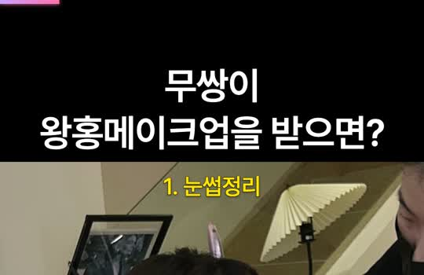
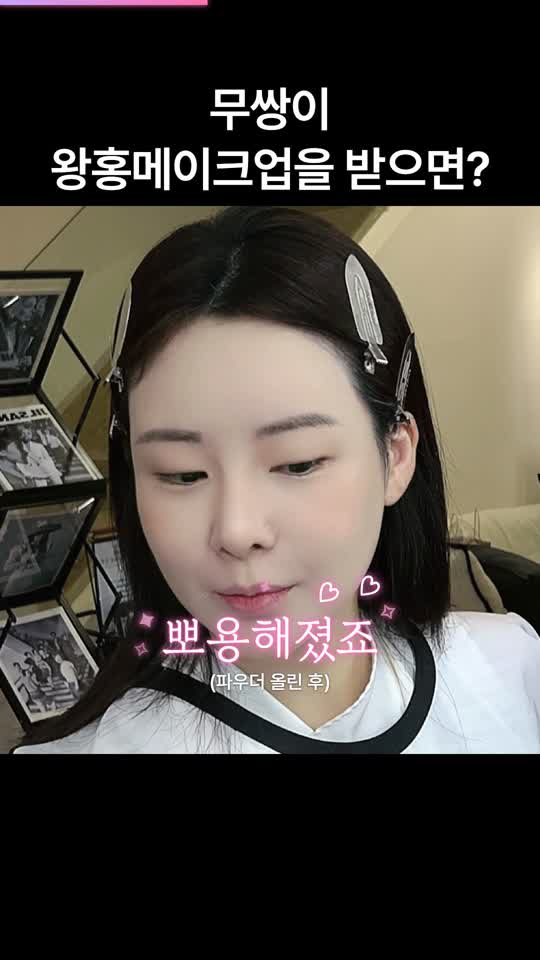
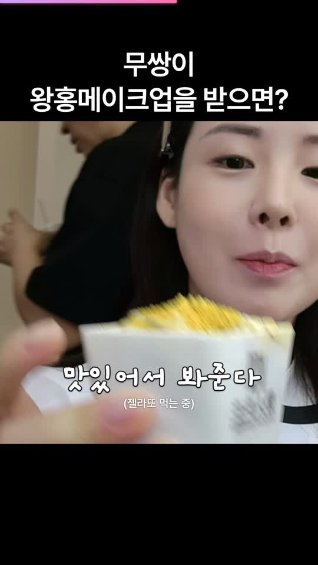
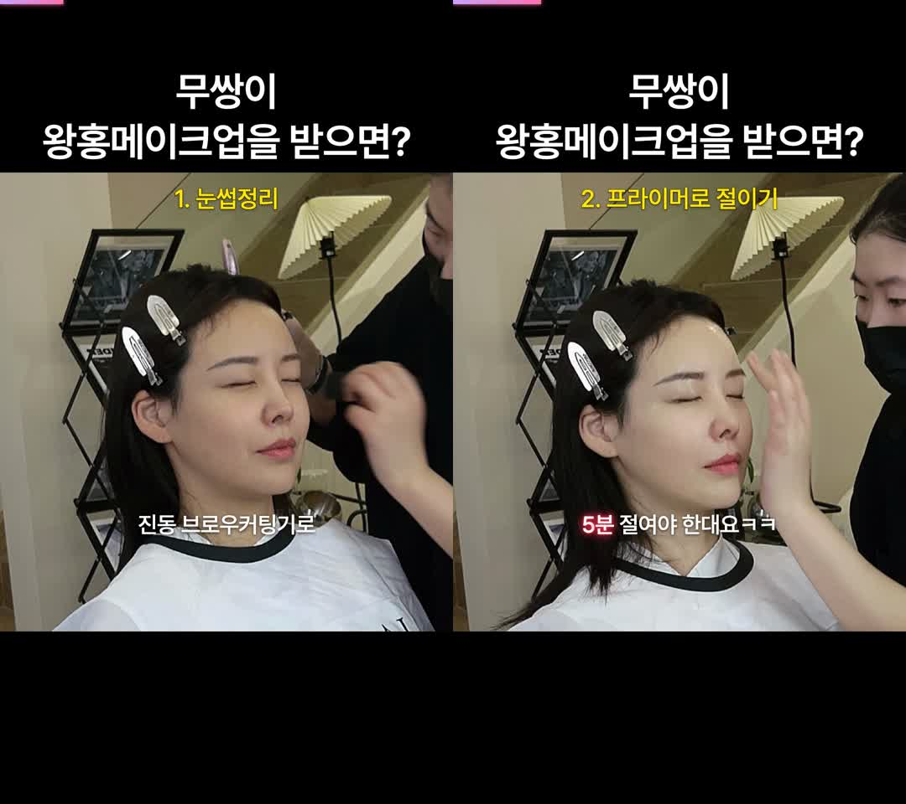
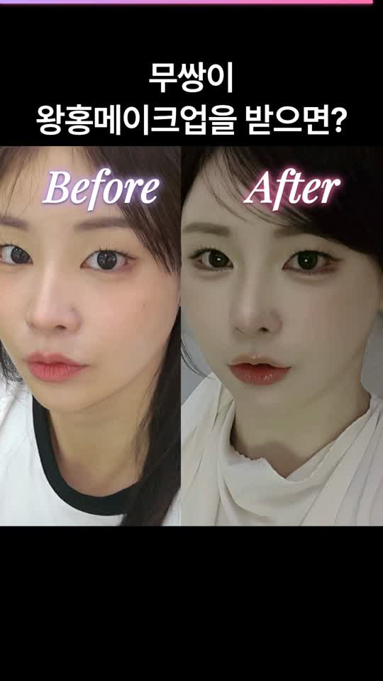

# 09. 자막·제목 스타일 가이드 (현재 확정본)

> 이 문서는 `editor/src/1010wh-editor/styles.ts`와 `Root.tsx`에서 **자동으로 뽑은 값**입니다. 값을 바꾸면 `python3 tools/make_style_doc.py`로 다시 만드세요.

크기는 모두 **1080×1920 세로 화면 기준 px**입니다. CapCut 등 다른 편집기에서 쓸 때는 화면 폭 1080 기준으로 비율을 맞추면 됩니다.

## 1. 화면 구성(삼등분)



| 영역 | y 범위(px) | 내용 |
|---|---|---|
| 위 검정 띠 | 0 ~ 412 | 제목. **아래 정렬**(여백 14px) → 영상 칸 바로 위에 붙음 |
| 영상 | 412 ~ 1508 | 1080×1096 영상 |
| 아래 검정 띠 | 1508 ~ 1920 | 비움(쇼츠 UI가 덮는 자리) |

자막 세로 위치(글자 위쪽 기준, 삼등분): `top 440`(단계 라벨) · `upper 600` · `middle 1000` · **`lower 1220`(기본 — 화면 중앙에서 살짝 아래)**

## 2. 제목 스타일

| 항목 | 값 |
|---|---|
| 문구 | `무쌍이 / 왕홍메이크업을 받으면?` |
| 프리셋 | `title2` — 흰 제목 (폰트2 위 띠) |
| 폰트 | PretendardSemiBold (`Pretendard-SemiBold.otf`) |
| 크기 | 96px (긴 줄이 화면 폭 1020px를 넘으면 자동 축소: 한글 1자 ≈ 0.78em) |
| 정렬 | 가운데, 위 띠의 아래쪽(영상 바로 위) |

```css
font-family: 'PretendardSemiBold';
font-size: 96px;
font-weight: 600;
color: #fff;
text-shadow: 0 2px 4px rgba(0,0,0,.6);
letter-spacing: -0.02em;
line-height: 1.25;
```

## 3. 자막 역할별 스타일

자막마다 역할(role)이 있고, 역할마다 쓸 스타일·연출을 정합니다. 개별 자막에서 덮어쓸 수 있습니다.

| 역할 | 뜻 | 스타일 | 연출 | 배율 |
|---|---|---|---|---|
| `basic` | 기본 말자막 | `basic_m` — [기본자막.png] 기본 — Pretendard Medium·그림자·예시의 2/3 크기 | `none` 없음 | 1.0 |
| `hand` | 손글씨 혼잣말 | `hx_hand` — [HxM6] 손글씨 "피부 : 살려줘" | `none` 없음 | 1.0 |
| `react` | 리액션·괄호 | `hx_react` — [HxM6] 리액션 "(칭찬 중)" — 둥근 손글씨·검정 굵은 테두리 | `pop` 통 튀어나오기 | 1.0 |
| `impact` | 임팩트(뷰티폰트1) | `white1` — [뷰티폰트1] 흰 명조 + 검정 테두리 | `pop` 통 튀어나오기 | 0.95 |
| `punch` | 펀치(뷰티폰트2) | `red_glow` — [빨간.png] 흰 제주명조 + 빨간 글로우 | `pop` 통 튀어나오기 | 1.0 |
| `pink` | 핑크 포인트 | `sha` — [샤랄라.png] 얇은 명조 + 분홍 글로우 (샤랄라 애니메이션과 함께) | `sparkle` 샤랄라(분홍·흰 별과 하트 반짝, 글로우 일렁임) | 1.0 |
| `title` | 오프닝·타이틀 | `sha` — [샤랄라.png] 얇은 명조 + 분홍 글로우 (샤랄라 애니메이션과 함께) | `sparkle` 샤랄라(분홍·흰 별과 하트 반짝, 글로우 일렁임) | 1.0 |

- 강조 단어 `{단어}` → `point_glow` ([빨간.png] 단어 강조 — 흰 글자 + 빨간 글로우)
- 보조자막(sub) → `hx_small` ([HxM6] 아래 작은 보조 "(배우고 싶었음)"), 위치 `below`
- 단계 라벨 → `label_thin` ([폰트2 얇게] 노랑 단계 라벨 — Pretendard Medium·얇은 테두리), 배율 1.0, 위치 `top`

## 4. 사용 중인 스타일 상세(CSS 그대로)

글로우는 `text-shadow` 3겹(10·24·44px × glowSize), 테두리는 `-webkit-text-stroke` + `paint-order: stroke fill`(글자 바깥쪽에만 테두리).

### `hx_small` — [HxM6] 아래 작은 보조 "(배우고 싶었음)"

폰트 파일: `editor/public/1010wh/Pretendard-Medium.otf`

```css
font-family: 'PretendardMedium';
font-size: 38px;
font-weight: 500;
color: #fff;
text-shadow: 0 0 4px rgba(0,0,0,.4), 0 1px 3px rgba(0,0,0,.4);
line-height: 1.2;
```

### `hx_react` — [HxM6] 리액션 "(칭찬 중)" — 둥근 손글씨·검정 굵은 테두리

폰트 파일: `editor/public/1010wh/Gaegu-Bold.ttf`

```css
font-family: 'GaeguBold';
font-size: 118px;
color: #fff;
-webkit-text-stroke: 9px #1e1e1e;
paint-order: stroke fill;
text-shadow: 0 5px 6px rgba(0,0,0,.3);
letter-spacing: -0.06em;
line-height: 1.0;
```

### `hx_hand` — [HxM6] 손글씨 "피부 : 살려줘"

폰트 파일: `editor/public/1010wh/YeonSung-Regular.ttf`

```css
font-family: 'YeonSung';
font-size: 88px;
color: #fff;
text-shadow: 0 0 5px rgba(0,0,0,.35), 0 3px 6px rgba(0,0,0,.45);
line-height: 1.15;
```

### `basic_m` — [기본자막.png] 기본 — Pretendard Medium·그림자·예시의 2/3 크기

폰트 파일: `editor/public/1010wh/Pretendard-Medium.otf`

```css
font-family: 'PretendardMedium';
font-size: 54px;
font-weight: 500;
color: #fff;
text-shadow: 0 0 6px rgba(0,0,0,.35), 0 3px 6px rgba(0,0,0,.45);
letter-spacing: -0.02em;
line-height: 1.25;
```

### `red_glow` — [빨간.png] 흰 제주명조 + 빨간 글로우

폰트 파일: `editor/public/1010wh/JejuMyeongjo-Regular.ttf`

```css
font-family: 'JejuMyeongjo';
font-size: 100px;
color: #fff;
-webkit-text-stroke: 1px rgba(255,255,255,.9);
paint-order: stroke fill;
text-shadow: 0 0 9px rgba(255,45,75,.85), 0 0 22px rgba(255,45,75,.85), 0 0 40px rgba(255,45,75,.85), 0 2px 3px rgba(120,0,20,.35);
letter-spacing: -0.03em;
line-height: 1.1;
```

### `point_glow` — [빨간.png] 단어 강조 — 흰 글자 + 빨간 글로우

폰트 파일: `editor/public/1010wh/Pretendard-Medium.otf`

```css
font-family: 'PretendardMedium';
font-size: 54px;
font-weight: 500;
color: #fff;
text-shadow: 0 0 6px rgba(255,45,75,.9), 0 0 14px rgba(255,45,75,.9), 0 0 26px rgba(255,45,75,.9);
letter-spacing: -0.02em;
line-height: 1.25;
```

### `sha` — [샤랄라.png] 얇은 명조 + 분홍 글로우 (샤랄라 애니메이션과 함께)

폰트 파일: `editor/public/1010wh/GowunBatang-Regular.ttf`

```css
font-family: 'GowunBatangReg';
font-size: 96px;
color: #fff;
-webkit-text-stroke: 2px rgba(255,170,215,.95);
paint-order: stroke fill;
text-shadow: 0 0 9px rgba(255,110,190,.85), 0 0 22px rgba(255,110,190,.85), 0 0 40px rgba(255,110,190,.85);
letter-spacing: -0.01em;
line-height: 1.15;
```

### `white1` — [뷰티폰트1] 흰 명조 + 검정 테두리

폰트 파일: `editor/public/1010wh/JejuMyeongjo-Regular.ttf`

```css
font-family: 'JejuMyeongjo';
font-size: 116px;
color: #fff;
-webkit-text-stroke: 9px #111;
paint-order: stroke fill;
text-shadow: 0 5px 6px rgba(0,0,0,.35);
letter-spacing: -0.04em;
line-height: 1.05;
transform: scaleX(0.86);
```

### `label_thin` — [폰트2 얇게] 노랑 단계 라벨 — Pretendard Medium·얇은 테두리

폰트 파일: `editor/public/1010wh/Pretendard-Medium.otf`

```css
font-family: 'PretendardMedium';
font-size: 58px;
font-weight: 500;
color: #ffe600;
-webkit-text-stroke: 3px rgba(0,0,0,.75);
paint-order: stroke fill;
text-shadow: 0 2px 6px rgba(0,0,0,.45);
letter-spacing: -0.01em;
line-height: 1.2;
```

### `title2` — 흰 제목 (폰트2 위 띠)

폰트 파일: `editor/public/1010wh/Pretendard-SemiBold.otf`

```css
font-family: 'PretendardSemiBold';
font-size: 96px;
font-weight: 600;
color: #fff;
text-shadow: 0 2px 4px rgba(0,0,0,.6);
letter-spacing: -0.02em;
line-height: 1.25;
```

### 미리보기

**제목(두 줄) + 첫 자막(샤랄라)**


**샤랄라(sha + sparkle) — 뽀용해졌죠**



**리액션(hx_react) — 맛있어서 봐준다**



**단계 라벨(label_thin)·기본 자막(basic_m)·강조 단어(point_glow)**



**엔딩 Before/After 라벨**



## 5. 연출 상세

| id | 설명 | 구현 요점 |
|---|---|---|
| `talk` | 말하듯 한 글자씩 톡톡 | 글자마다 spring(0.6→1)+아래서 18px 올라옴, 자막 길이 60% 안에 다 나옴(talkSpeed 0.06초/자) |
| `type` | 타이핑(글자 순서대로) | 글자 순서대로 즉시 표시 |
| `pop` | 통 튀어나오기 | 자막 전체 spring scale 0.6→1 |
| `wave` | 등장 후 물결 | 글자별 sin 위아래 6px |
| `shake` | 흔들림(강조) | scale 0.7→1 + 10프레임 ±3° 흔들림 |
| `fade` | 부드럽게 블러인 | 8프레임 블러 10→0px + 투명→불투명 |
| `sparkle` | 샤랄라(분홍·흰 별과 하트 반짝, 글로우 일렁임) | 블러인 + 분홍 글로우 세기 0.75~1.1 일렁임 + 글자 위·옆 8곳에 ✦✧♡(분홍 #ffb3dc/흰색, 34~42px, 분홍 글로우)가 28프레임 주기로 크기 0.4→1.2 반짝 |
| `starfield` | 별무리(CapCut식 흰 반짝이 왼→오 퍼짐) | 글자 왼→오 마스크 공개(22프레임) + 흰 ✦·빛가루 60개가 앞을 따라 퍼짐 + 이후 흰 ✦ 14개 반짝 |
| `none` | 없음 | 바로 표시(기본 말자막) |

기타 효과: `zoom`(자막 동안 영상 1→1.12 확대), `flash`(3프레임 흰 번쩍 rgba(255,240,248,.7)), `labels`(Before/After — Playfair Display Italic 700, 120px, 흰색, 그림자 0 3px 6px rgba(0,0,0,.55) + 보라 #c8a2ff / 분홍 #ff6fae 글로우).

## 6. 줄바꿈·크기 자동 규칙

- 큰 글씨(실제 90px 이상)는 10자, 작은 글씨는 18자를 넘으면 가운데에 가까운 띄어쓰기에서 두 줄. `{ }` 안은 나누지 않음.
- 줄이 화면 폭(1000px)을 넘으면 `1000 / (글자수 × 0.92 × 가로비율)`로 축소.
- 원하는 곳에서 끊으려면 문구에 줄바꿈을 직접 넣음.
- 제주명조의 `?!`는 폭이 넓어 Gowun Batang으로 대체.

## 7. 자막 전체 목록(현재 값)

| # | 시작(초) | 길이 | 역할 | 스타일 | 연출 | 문구 | 보조자막 | 단계 |
|---|---|---|---|---|---|---|---|---|
| 0 | 0.00 | 1.30 | title | `sha` | `sparkle` | 무쌍이 / 왕홍메이크업 받으면 |  |  |
| 1 | 1.30 | 1.60 | punch | `red_glow` | `pop` +zoom +flash | 쌍꺼풀이 / 생긴다구?!?! |  |  |
| 2 | 2.90 | 2.30 | title | `sha` | `sparkle` +flash +Before/After | 비포-애프터 |  |  |
| 3 | 5.20 | 1.15 | basic | `basic_m` | `none` | 우선 이 클렌징오일로 |  |  |
| 4 | 6.35 | 0.94 | basic | `basic_m` | `none` | 세안하고 오래요 |  |  |
| 5 | 7.29 | 0.90 | react | `hx_react` | `pop` | (쌩얼비포) |  |  |
| 6 | 8.19 | 1.28 | hand | `hx_hand` | `none` | 저는 이렇게 해달라했어요 |  |  |
| 7 | 9.48 | 0.90 | basic | `basic_m` | `none` | 시작! |  | 1 눈썹정리 |
| 8 | 10.38 | 1.08 | basic | `basic_m` | `none` | 진동 브로우커팅기로 |  | 1 눈썹정리 |
| 9 | 11.46 | 1.15 | basic | `basic_m` | `none` | 깔끔하게 정리해주시고 |  | 1 눈썹정리 |
| 10 | 12.60 | 0.90 | basic | `basic_m` | `none` | 뭔가 로션 같은 걸 얹어주시는데 |  | 2 프라이머로 절이기 |
| 11 | 13.50 | 1.00 | basic | `basic_m` | `none` | 눈떠보니 프라이머였음 |  | 2 프라이머로 절이기 |
| 12 | 14.50 | 1.10 | basic | `basic_m` | `none` | {5분} 절여야 한대요ㅋㅋ |  | 2 프라이머로 절이기 |
| 13 | 15.60 | 0.90 | basic | `basic_m` | `none` | 흡수시키고 |  |  |
| 14 | 16.50 | 0.90 | basic | `basic_m` | `none` | 잔여물 닦고 |  |  |
| 15 | 17.40 | 0.80 | basic | `basic_m` | `none` | 보정?하는 얇은 수분밤 같은 걸 발라주시고 |  |  |
| 16 | 18.20 | 0.80 | hand | `hx_hand` | `none` | 다이소 본셉 글로우랑 되게 비슷했음 | (수분밤 느낌) |  |
| 17 | 19.00 | 1.01 | basic | `basic_m` | `none` | 파데를 얇게 깔고 |  | 3 베이스 |
| 18 | 20.02 | 1.08 | basic | `basic_m` | `none` | 큰 퍼프로 두드리고 |  | 3 베이스 |
| 19 | 21.10 | 1.20 | basic | `basic_m` | `none` | 작은 퍼프로 한번더 꼼꼼하게 |  | 3 베이스 |
| 20 | 22.30 | 1.01 | basic | `basic_m` | `none` | 컨실러 얇게 깔고 |  | 3 베이스 |
| 21 | 23.31 | 1.90 | basic | `basic_m` | `none` | 광대 콧잔등 윗입술 턱중앙 눈두덩에 / 블러셔 얇게 들어가고 |  | 4 블러셔 |
| 22 | 25.21 | 1.08 | react | `hx_react` | `pop` | (픽서를 뿌립니다) |  | 5 픽서 |
| 23 | 26.29 | 0.90 | react | `hx_react` | `pop` | (말려줍니다) |  | 5 픽서 |
| 24 | 27.19 | 0.90 | basic | `basic_m` | `none` | 요 상태에서 |  |  |
| 25 | 28.09 | 1.40 | basic | `basic_m` | `none` | 위에 파우더로 덮더라구요..! |  |  |
| 26 | 29.49 | 1.50 | pink | `sha` | `sparkle` | 뽀용해졌죠 | (파우더 올린 후) |  |
| 27 | 30.99 | 1.35 | basic | `basic_m` | `none` | 그리고 다시 블러셔 위치에 |  |  |
| 28 | 32.34 | 1.15 | basic | `basic_m` | `none` | 하이라이트 들어갔구요 |  |  |
| 29 | 33.49 | 0.90 | basic | `basic_m` | `none` | 음영 |  | 6 아이메이크업 |
| 30 | 34.39 | 0.90 | basic | `basic_m` | `none` | 애교 |  | 6 아이메이크업 |
| 31 | 35.29 | 0.90 | basic | `basic_m` | `none` | 눈 앞머리 |  | 6 아이메이크업 |
| 32 | 36.19 | 0.90 | basic | `basic_m` | `none` | 그림자 생성 |  | 6 아이메이크업 |
| 33 | 37.09 | 0.90 | basic | `basic_m` | `none` | 밑트임 |  | 6 아이메이크업 |
| 34 | 37.99 | 1.56 | basic | `basic_m` | `none` | 그리고 {눈치 없는} 중국오빠들.. |  |  |
| 35 | 39.54 | 1.90 | hand | `hx_hand` | `none` | 아니 젤라또 갖고 온 거 왜케 재밌냥ㅋㅋ |  |  |
| 36 | 41.44 | 1.28 | basic | `basic_m` | `none` | 아직 립 안 해서 봐준다 |  |  |
| 37 | 42.72 | 1.50 | react | `hx_react` | `pop` +zoom | 맛있어서 봐준다 | (젤라또 먹는 중) |  |
| 38 | 44.22 | 1.22 | pink | `sha` | `sparkle` | 이것이 바로 왕홍 애교💗 | (애교살 강조) |  |
| 39 | 45.44 | 1.56 | hand | `hx_hand` | `none` | 애교 레이어를 엄청 쌓아주셨어요 |  |  |
| 40 | 47.00 | 1.28 | basic | `basic_m` | `none` | 아이라인 섀도로 빼주시고 |  | 6 아이메이크업 |
| 41 | 48.28 | 0.90 | basic | `basic_m` | `none` | 마스카라 |  | 6 아이메이크업 |
| 42 | 49.18 | 0.90 | basic | `basic_m` | `none` | {쌍테+풀} |  | 7 쌍꺼풀 |
| 43 | 50.08 | 1.01 | hand | `hx_hand` | `none` | 역시 내 눈두덩이 |  | 7 쌍꺼풀 |
| 44 | 51.09 | 1.50 | impact | `white1` | `pop` +zoom | 쌍꺼풀 안 보이죠ㅋㅋ | (쌍테+풀 붙였는데) | 7 쌍꺼풀 |
| 45 | 52.59 | 1.22 | basic | `basic_m` | `none` | 눈에 힘을 안 줘야겠다 | (쌍꺼풀 사수) |  |
| 46 | 53.81 | 1.22 | basic | `basic_m` | `none` | 속눈썹은 거의 {12미리} |  | 8 속눈썹 |
| 47 | 55.02 | 0.90 | basic | `basic_m` | `none` | 핀셋으로 쫑쫑 |  | 8 속눈썹 |
| 48 | 55.92 | 1.50 | pink | `sha` | `sparkle` +zoom | 요래됐습당 | (메이크업 완성) |  |
| 49 | 57.42 | 1.62 | basic | `basic_m` | `none` | 입술은 디테일하게 안 하시더라고요 |  | 9 립 |
| 50 | 59.05 | 1.40 | basic | `basic_m` | `none` | 헤어까지 {완성} |  |  |
| 51 | 60.45 | 1.50 | basic | `basic_m` | `none` | 헤메 {12만원} 나왔어요 | (헤어+메이크업) |  |
| 52 | 61.95 | 1.90 | basic | `basic_m` | `none` | 젤네일 연장하고 캔 따면 안 되는 것처럼 |  |  |
| 53 | 63.84 | 1.90 | hand | `hx_hand` | `none` | 표정을 크게 지으면 안 될 것 같은 느낌! |  |  |
| 54 | 65.74 | 0.90 | react | `hx_react` | `pop` | 자연광 샷 |  |  |
| 55 | 66.64 | 1.76 | basic | `basic_m` | `none` | 오히려 {푸슬푸슬} 느낌이 더 강해졌달까 | (자연광에서 보면) |  |
| 56 | 72.07 | 3.50 | impact | `white1` | `pop` | 여러분 선택은? | (비포 vs 애프터) |  |
| 57 | 75.57 | 2.90 | title | `sha` | `sparkle` +flash +Before/After | (라벨만) |  |  |

## 8. CapCut에서 손으로 따라 할 때

| Remotion 값 | CapCut 설정 |
|---|---|
| font-size(px, 1080 기준) | 텍스트 크기 — 1080 폭 프로젝트에서 같은 비율로 맞춤(미리보기와 나란히 놓고 조절) |
| -webkit-text-stroke | 스타일 → 획(Stroke): 색·두께 |
| text-shadow(검정) | 스타일 → 그림자: 검정, 불투명도 35~45%, 흐림 높게, 거리 2~3 |
| 글로우(text-shadow 0 0) | 스타일 → 발광(Glow) 또는 그림자(거리 0, 흐림 최대, 색=글로우색) |
| scaleX(0.86) | 텍스트 가로 비율 86%(지원 안 되면 자간을 좁혀 대체) |
| sparkle | 텍스트 효과 '반짝임'류 + 하트/별 스티커 |
| starfield | 효과 '별무리' |
